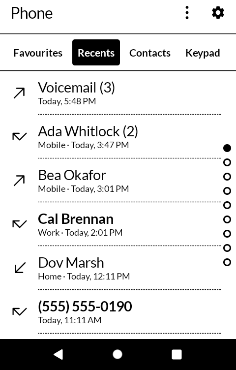
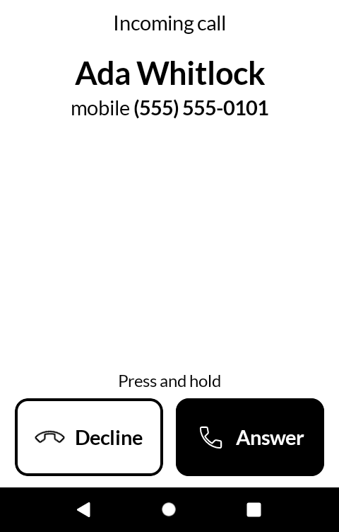
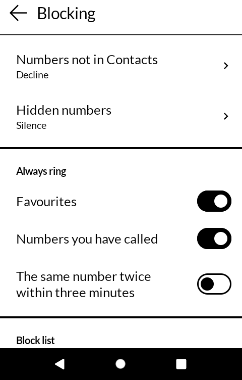
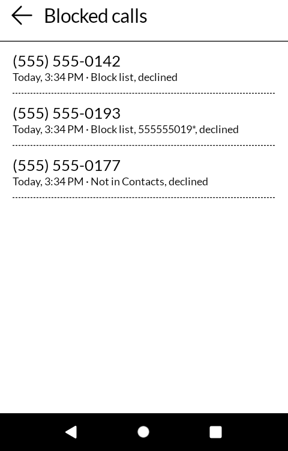

# 糸電話 itodenwa — Phone

A phone app for the [Mudita Kompakt](https://mudita.com/products/kompakt/): Favourites, Recents,
Contacts, a keypad, and the call screen, built with Mudita's [MMD](https://github.com/mudita/MMD)
design system and laid out like the phone's own Phone app. It installs on any Android 12 device.

*Itodenwa* is 糸電話 — the string telephone, two cans and a length of string.

It began as a fork of [Fossify Phone](https://github.com/FossifyOrg/Phone) and keeps its history;
most of it has since been written again for the Kompakt, and the parts still taken from Fossify
are named where they are used.

| | |
|---|---|
|  |  |
|  |  |

## What it does

- **Nothing in a list calls.** A press on a recent call, a favourite or a contact opens their
  page, with **Call**, **Message** and their card in Contacts as three big buttons and every call
  with them underneath. The phone's own Recents dials on a single tap, which is how calls get
  made by a thumb meant for scrolling.
- **Names for every number in Recents**, however the number was written. A contact saved as
  "+1 555-555-0143" is found for a call from "5555550143", and "+44 7700 900123" for
  "07700 900123". Android's own lookup is asked first, then the number in its international
  form for the country the phone is in, and then every number on every card, compared by its
  last digits with the trunk zero and the country code set aside.
- **Hold to answer.** A call coming in shows over the lock screen, the panel woken. **Decline**
  and **Answer** each act only when held down: the button fills in three steps over about half a
  second and acts on the third, and lifting early undoes it. While it rings, a covered proximity
  sensor — a pocket, a bag — turns every touch away. A hold rather than a slide, because a slide
  on this panel is a smear of half-drawn frames behind the thumb.
- **During a call**: Mute, Speaker, Keypad and Hold, each black while it is on, and End call
  across the foot. With the keypad up, Mute and Speaker stay beside it. A second call shows who is
  held or waiting, with Swap, and Merge where the network allows it. The panel stays on through
  the call, and goes off at the ear. The volume keys set the call's volume over the phone's full
  range.
- **Blocking, on the phone and nothing else.** In **Settings → Blocking**, numbers not in
  Contacts and hidden numbers can each be set to **Ring**, **Silence** or **Decline**. Silence
  lets the call in without a sound or the call screen: it is in Recents and goes to voicemail.
  Decline turns it away. A number counts as "not in Contacts" only when the contacts were read
  and it is not there, so a phone slow to answer never turns a friend away. All of it is off
  until you turn it on.
- **Always ring**: favourites, numbers you have called, and the same number calling twice within
  three minutes can each be let past the rules.
- **A block list** of whole numbers and starts of numbers: `555*` blocks every number beginning
  555, `+44*` every number from the UK. Hold a row in Recents and press **Block**, or press Block
  on a number's page; each asks by changing what it says, and a second press does it. A blocked
  number's calls leave Recents. Whole numbers go into Android's own blocked-numbers list, which
  messaging apps honour too. The list goes out to a file and comes back in Fossify's format.
- **Blocked calls**, in Recents' ⋮: every call turned away or silenced in the last thirty days,
  when, who, and which rule did it, with **Unblock** and **Add to Contacts**.
- **Delete** a row of Recents from its long press, or **Clear all** from the ⋮, each asking first.
- **Missed calls** get a notification with **Call back** and **Message**; it opens Recents, and
  goes once Recents has been seen.
- **Voicemail**: hold 1 on the keypad, or press Voicemail in Recents' ⋮. The call screen and
  Recents say "Voicemail", not the carrier's number for it. A voicemail notification, where the
  carrier sends one, calls it and goes once it is called.
- **Speed dial**: hold 2 to 9 on the keypad to call the person set on it in **Settings → Speed
  dial**, where 1 is shown as Voicemail's.
- **Through Do Not Disturb**, favourites, and someone calling a second time within three minutes,
  can still ring, each a switch in **Settings → Ringing**, off to start with.
- **Ringtones**: a contact's own ringtone, chosen on their card, rings for them, and numbers not
  in Contacts can have a ringtone of their own, in **Settings → Ringing**.
- **Settings look like Messaging's**, the two being a pair: the cog at the top right, a list of
  rows each with its value under it, and About behind the i.
- **A keypad** with the letters on its keys: typing finds people by the start of a name or by part
  of a number, and pressing one fills in their number — it still waits for Call. With nothing
  typed, Call puts the last number called back in the box.
- **An emergency number is never dialled for you.** A held key, a speed dial or Call back on a
  notification puts it on the keypad instead, for Call to be pressed.
- **Message** opens a new message to the number in the phone's messaging app.
- **Contacts stay in Contacts.** Phone reads the contacts and never changes them: the Contact
  button opens the person's card in [Contacts](https://github.com/wanderwildwood/enishi) when it
  is installed, or in whatever contacts app the phone has, and Add puts a number from Recents on
  a new card or an existing one there. A person starred in Contacts is listed under Favourites.
- **Long lists** have letters down the edge of Contacts and page dots beside Recents.

## Making it the phone app

Calls only come to this app's call screen once it is the phone's default phone app. Until it is,
a line at the top of the app says so, and pressing it asks Android to make the change. Android
then hands every call — in or out, from any app — to Phone, and asks it about every call coming
in before it rings, which is how blocking works without any other permission. The phone's own
ringer rings, with the ringtone and volume set in the phone's settings. To go back, press
**Settings → Stop being the phone app**, and choose another in Default apps.

In Default apps, App info and DuraSpeed's list it is called **Phone (itodenwa)**, because the
Kompakt's own dialer is called Phone there too. In the app drawer it is Phone.

If another app is set as the phone's caller ID and spam app, Android asks that app instead, and
Blocking says so.

## On a Kompakt: DuraSpeed

DuraSpeed shuts apps down a few minutes after the screen goes dark, and a phone app shut down
that way misses its calls. Right after it becomes the phone app, Phone asks: press **Open
DuraSpeed**, tap **Open** there, and switch **Phone (itodenwa)** on. Back in Phone, it asks
whether that is done. If the question is never answered, it comes back the next time Phone
opens; after that it waits behind **Settings → DuraSpeed** until it is done.

## With the other apps

- **Contacts** ([enishi](https://github.com/wanderwildwood/enishi)) opens for a person's card,
  for adding a number, and is where favourites are starred.
- **Messaging** ([kotozute](https://github.com/wanderwildwood/kotozute)), or whichever app is
  the phone's messaging app, opens for Message and Text back.
- **Notes** ([oboegaki](https://github.com/wanderwildwood/oboegaki)) takes a note about a call,
  from the ⋮ on the call screen, when it is installed.
- Any app that asks for a keypad (`DIAL`, a `tel:` link) gets this one, with the number typed
  and waiting for Call.

## What it does not do

- **Nothing leaves the phone.** The app has no internet permission, and no list of spam numbers
  from anywhere: the rules are yours. See [PRIVACY.md](PRIVACY.md) for what it asks for and why.
- **No video calls, no call recording, no visual voicemail.**

## Building

```
./gradlew assembleDebug
```

A release build needs a keystore at `signing/signing.keystore` with a matching
`signing/signing.properties`. There is no fallback key in this repository: without one, a
release build comes out unsigned rather than wrongly signed.

## Getting it, and keeping it

Download <https://github.com/wanderwildwood/itodenwa/releases/latest/download/itodenwa.apk>
and sideload it, then choose it as the default phone app when it asks. That address always
points at the newest release, and every release publishes a `.sha256` beside the APK if you
would rather check than trust.

For updates without doing this by hand, add this repository to
[Obtainium](https://github.com/ImranR98/Obtainium):

    https://github.com/wanderwildwood/itodenwa

## Licence

GPL-3.0-only. See [LICENSE](LICENSE).

Copyright (C) 2026 wander wildwood
Portions copyright Fossify contributors.

This program is free software: you can redistribute it and/or modify it under the terms of the
GNU General Public License as published by the Free Software Foundation, version 3.

This program is distributed in the hope that it will be useful, but WITHOUT ANY WARRANTY;
without even the implied warranty of MERCHANTABILITY or FITNESS FOR A PARTICULAR PURPOSE. See
the GNU General Public License for more details.

You should have received a copy of the GNU General Public License along with this program. If
not, see <https://www.gnu.org/licenses/>.

Icons are from Material Symbols, Apache 2.0, or drawn on their grid.

## Where it comes from

Phone began as a fork of [Fossify Phone](https://github.com/FossifyOrg/Phone) (GPL-3.0), at its
1.11.1 release, and its history is kept in this repository. From it come the way calls are kept
and acted on while they last (its CallManager, itself inspired by
[call_manage](https://github.com/Chooloo/call_manage)), the in-call service, the call
notification and its buttons, the keypad's tones, the grouping of calls in a row in Recents,
and its call screener and block-list file format, from
[Fossify Commons](https://github.com/FossifyOrg/Commons). The missed-call notification follows
AOSP's MissedCallNotifier (Apache-2.0). The letters and page dots beside long lists are adapted
from [inkOS](https://github.com/gezimos/inkOS) (GPL-3.0).
Its screens and its shared library were replaced: the screens are Mudita's MMD, drawn to sit
beside Contacts and the Kompakt's own Phone app.
